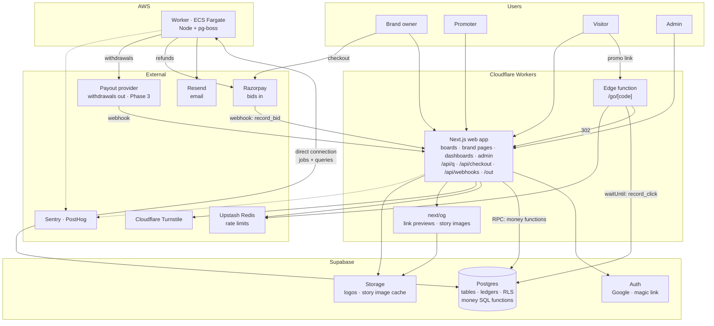
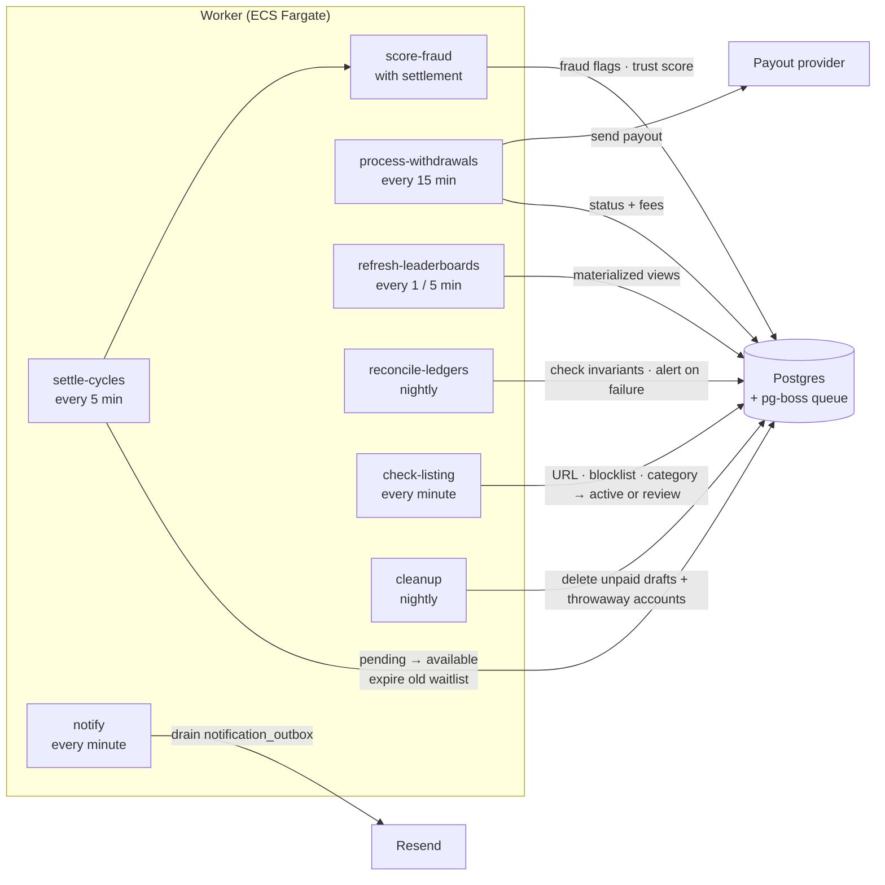
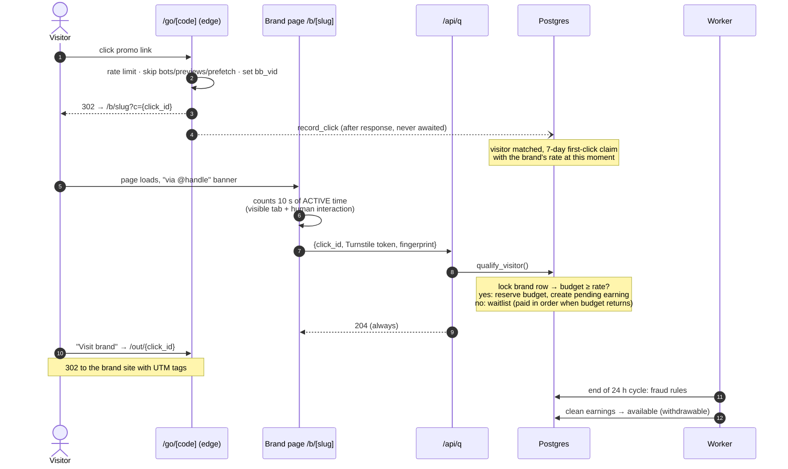
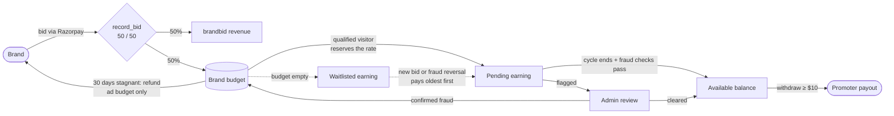

# brandbid

A public pay-to-rank brand leaderboard (modelled on outbid.lol) with a built-in promotion network.

- **Brands** pay to claim a rank. Each payment (a *bid*) is split 50% brandbid revenue / 50% into that brand's own ad **budget**.
- **Promoters** tap **Advertise** on any brand, get a unique link, and share it to an Instagram story, LinkedIn, X, or anywhere else.
- **Visitors** who click a link land on the brand's page on brandbid. A visitor who is new to that brand and stays active for 10 seconds is a **qualified visitor**.
- Each qualified visitor moves the brand's per-visitor **rate** (≥ $0.10) from the brand's budget to the promoter who brought them.
- Earnings settle in 24-hour **cycles** and are withdrawable once settled (minimum $10).

Domain: `brandbid.wtf` · Links: `brandbid.wtf/go/{code}`

## Where to read what

| File | Purpose |
| --- | --- |
| [BUILD.md](BUILD.md) | Source of truth: product decisions (§3 log), data model, money rules, every flow. Wins over everything else. |
| [PHASES.md](PHASES.md) | The build plan: 4 phases split into work packages with specs and acceptance checks. |
| [CLAUDE.md](CLAUDE.md) | Short context for coding agents, plus the live progress table. |
| [DEPLOYMENT.md](DEPLOYMENT.md) | How to deploy: Cloudflare (web), Supabase, AWS (worker). Start here to set up environments. |

## Architecture

### System overview



**The rule that shapes everything:** money never depends on the worker. Budget is reserved at qualification inside the web request, in one database transaction. The worker only releases money to promoters afterwards. If the worker is down, payouts are delayed, but no money is lost or duplicated.

### What the worker does



| Job | Job of the job |
| --- | --- |
| `settle-cycles` | Finds earnings whose 24 h cycle has ended, runs the fraud rules, makes clean ones withdrawable, holds flagged ones for review, expires old waitlist entries |
| `score-fraud` | Rules R1–R9 and trust scores |
| `process-withdrawals` | Sends `processing` withdrawals to the payout provider, records fees, marks paid or failed |
| `refresh-leaderboards` | Daily board (every minute) and promoter boards (every 5 min) |
| `reconcile-ledgers` | Verifies every money invariant in BUILD §7; strips user agents older than 90 days |
| `notify` | Sends queued emails from `notification_outbox` (listing approved / rejected so far; the rest arrive with Phase 3) |
| `process-refunds` | Returns the money for rejected listings through the payment processor, retrying with backoff |
| `check-listing` | Automatic checks on a freshly paid listing (approve, or hold for an admin with the reason) |
| `cleanup` | Deletes unpaid draft listings and throwaway accounts older than 7 days |

### Life of a promo click



### Money flow



Refund rules: a stagnant brand can get back only its unspent **ad budget**, never brandbid's 50% (D37). A rejected listing is refunded in full (D38).

### Environments

| Env | Web | Database | Worker | Payments |
| --- | --- | --- | --- | --- |
| Local | `pnpm dev` | `supabase start` (Docker) | `pnpm --filter worker dev` | Razorpay test mode |
| Preview | Cloudflare preview version | Staging Supabase | not run | Test mode |
| Staging | Cloudflare Worker `brandbid-staging` | Staging Supabase | AWS Fargate staging | Test mode |
| Production | Cloudflare Worker `brandbid-prod` | Production Supabase | AWS Fargate production | Live |

## Tech stack

TypeScript (strict) · pnpm monorepo · Next.js App Router + Tailwind · Supabase (Postgres, Auth, Storage) · Cloudflare Workers via OpenNext (web + edge) · AWS ECS Fargate (worker) · pg-boss · Razorpay · Cloudflare Turnstile · FingerprintJS · Upstash Redis · Resend · Sentry · PostHog · Vitest, SQL tests, Playwright.

## Repository layout

```
brandbid/
  apps/
    web/        Next.js: boards, brand pages, dashboards, admin, /go, /out, /api/*
    worker/     pg-boss jobs (the table above)
  packages/
    db/         migrations, money SQL functions, SQL tests, generated types
    shared/     money helpers (cents), codes, hashing, zod schemas
    emails/     email templates
  BUILD.md  PHASES.md  CLAUDE.md  README.md
```

> Status: planning is done; the repo has docs only. Build progress is tracked in the table in [CLAUDE.md](CLAUDE.md#progress).

## Getting started

Not available yet. Commands (`pnpm dev`, `supabase start`, tests) will be listed here when P1.1 (repo and tooling) is done.
